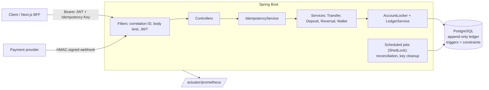

# Digital Wallet & Double-Entry Ledger Engine

A wallet backend where every money movement is a balanced pair of ledger entries and balances are **derived from the ledger, never written**. It's built to show one thing: **correctness and auditability for money-shaped data under concurrency, retries and hostile input**.

**Stack:** Java 21 · Spring Boot 3.5 · PostgreSQL 16 · Flyway · Spring Security (JWT) · Testcontainers · Docker

**What it demonstrates:**
- **Append-only, double-entry ledger** enforced in Java *and* by Postgres triggers, constraints and privileges.
- **ACID transfers** with row locks taken in a deterministic order: no overspend and no deadlocks under 50–100 parallel requests.
- **Idempotency keys**, reserved before any state change; the response is stored in the same transaction as the money movement.
- **Argon2id passwords**, short-lived JWTs, and rotating refresh tokens with reuse detection.
- **Role checks** plus 404-not-403 ownership scoping, with a build-time guard that every endpoint declares its access rule.
- **HMAC-signed payment webhooks:** raw-byte verification, replay protection, event idempotency and secret rotation.
- **Reversals** that never modify history.
- **Nightly reconciliation** on a consistent snapshot, which catches deliberately injected corruption.
- **210+ tests** against real Postgres, no H2 and no mocked database.

## Architecture



Layering: `Controller → Service (@Transactional) → Repository / JdbcTemplate`. Controllers hold no business logic.

## Ledger design

Every movement is a `transactions` row with two or more `ledger_entries` (legs). For every account, **balance = Σ CREDIT − Σ DEBIT**. Per transaction and currency, debits equal credits.

| Event | DEBIT | CREDIT |
|---|---|---|
| Deposit settles | `EXTERNAL_FUNDING` system account | user wallet |
| Transfer | sender wallet | receiver wallet |
| Reversal | mirror image of the original | |

There are **system accounts** per currency (INR, USD, EUR): `EXTERNAL_FUNDING`, `REFUNDS_CLEARING` and `FX_CLEARING`. They may go negative; user wallets never may. More in [docs/ledger-design.md](docs/ledger-design.md).

**Defence in depth:** each rule is enforced in more than one place.

| Rule | Java | Database |
|---|---|---|
| Balanced double-entry | `LedgerService.assertBalanced` | `CONSTRAINT TRIGGER … DEFERRABLE INITIALLY DEFERRED`, checked at COMMIT |
| Append-only | inserts only, via JDBC | trigger rejects UPDATE/DELETE/TRUNCATE, and the app role has no UPDATE/DELETE grant |
| Leg currency = account currency | `LedgerService` | composite foreign key |
| Reverse at most once | `ReversalService` | partial unique index |

## Why PostgreSQL

Money needs ACID transactions across several rows, `SELECT … FOR UPDATE`, foreign keys, CHECK constraints, unique indexes for idempotency, and triggers that run in the same transaction as the write. A document store would push all of that into application code. See ADR-014 on why there's no Redis or Kafka either.

## Concurrency strategy

1. Lock the user wallets involved, **in UUID order**, through `AccountLocker` only. The same order everywhere means no deadlock cycles.
2. Check the balance **after** acquiring the lock, at READ COMMITTED, so the SUM sees every committed write.
3. Post the legs, audit and commit, which releases the locks.

Alternatives (optimistic locking, SERIALIZABLE with retries, a per-account queue) and why they weren't chosen are in [ADR-012](docs/decisions.md). Proven by `TransferConcurrencyIT`: 50 parallel ₹100 transfers from a ₹1,000 wallet give exactly 10 successes, and 100 opposing A↔B transfers give zero deadlocks with totals conserved.

## Idempotency

```mermaid
sequenceDiagram
    participant C as Client
    participant A as API
    participant DB as Postgres
    C->>A: POST /transfers  Idempotency-Key: k1
    A->>DB: INSERT idempotency_keys(k1, hash, IN_PROGRESS) ON CONFLICT DO NOTHING  [commit]
    A->>DB: BEGIN; lock key row; lock wallets; post legs; store response, COMPLETED; COMMIT
    A-->>C: 201 {transaction}
    C->>A: retry: same key, same body
    A->>DB: INSERT … conflict → row is COMPLETED, hash matches
    A-->>C: 201 {same body}  Idempotent-Replayed: true
    C->>A: same key, different body
    A-->>C: 422 IDEMPOTENCY_KEY_REUSED
```

- **Concurrent duplicates** wait briefly, then get the replay (or `409 IDEMPOTENCY_REQUEST_IN_PROGRESS`).
- **4xx business errors** are stored and replayed too; a **5xx** releases the key.
- **Keys** are per user, kept for 24h, and purged daily.
- **Missing header:** `400 IDEMPOTENCY_KEY_REQUIRED` on every mutating endpoint except `/auth/*` and the webhook.

Why a service wrapper rather than a filter is explained in [ADR-013](docs/decisions.md).

## Webhook security

```
X-Webhook-Timestamp: 1730000000
X-Webhook-Signature: hex(HMAC-SHA256(secret, "1730000000." + rawBody))
```

- **Verified on the raw request bytes,** before JSON parsing, with a constant-time comparison.
- **Timestamp skew over 5 min → 401.** The timestamp is inside the MAC, so it can't be changed.
- **Two secrets are accepted** during rotation.
- **Every event is stored,** including forgeries, which get synthetic ids so they can't block a real event.
- **`(provider, provider_event_id)` is unique,** so a duplicate returns 200 with no reprocessing.
- **The deposit row is locked while settling,** and the amount must match the deposit.

See [ADR-015](docs/decisions.md).

## Reversal model

`POST /api/v1/admin/transactions/{id}/reverse` (ADMIN only) posts a `REVERSAL` transaction with mirrored legs and `reversal_of_transaction_id`. The original is never touched. Errors:
- reversing twice → `409 ALREADY_REVERSED`;
- reversing a reversal → `422 REVERSAL_NOT_ALLOWED`;
- a wallet would go negative → `422 INSUFFICIENT_FUNDS_FOR_REVERSAL`.

Every reversal is audited with its reason.

## Reconciliation

Runs nightly at 02:00 IST (`@Scheduled` + ShedLock, one instance only) or via `POST /api/v1/admin/reconciliation/run`. All checks read one REPEATABLE READ snapshot:

1. Global debits = credits, per currency.
2. Every transaction balances and has both a DEBIT and a CREDIT.
3. No user wallet is negative.
4. Cached balances: not applicable; balances are always derived (ADR-011).
5. Each SUCCEEDED deposit has exactly one matching DEPOSIT transaction, and vice versa. PENDING for over 24h is a warning.
6. No transaction is reversed twice, and no reversal is itself reversed.

Results are stored in `reconciliation_runs`. On failure the run logs at ERROR and increments `ledger.reconciliation.mismatches`.

## API

Full contract: **[backend/openapi.json](backend/openapi.json)**. When running locally there's also Swagger UI at http://localhost:8080/swagger-ui.html. The Bruno collection is in [api-collection/](api-collection).

| Area | Endpoints | Who |
|---|---|---|
| Auth | `POST /api/v1/auth/{register,login,refresh,logout,logout-all}`, `GET /api/v1/me` | public / any |
| Wallets | `POST,GET /api/v1/wallets`, `GET /wallets/{id}`, `/wallets/{id}/entries`, `/wallets/{id}/balance-history` | CUSTOMER, ADMIN (own) |
| Transfers | `POST /api/v1/transfers` | CUSTOMER |
| Deposits | `POST /api/v1/deposits`, `GET /deposits/{id}` | CUSTOMER |
| Webhook | `POST /api/v1/webhooks/payment-provider` | HMAC signature |
| Transactions | `GET /api/v1/transactions`, `/transactions/{id}`, `GET /api/v1/dashboard/summary` | CUSTOMER, ADMIN (own) |
| Admin | `POST /admin/transactions/{id}/reverse`, `GET /admin/wallets`, `POST /admin/wallets/{id}/{freeze,unfreeze}`, `GET /admin/overview`, `POST /admin/reconciliation/run` | ADMIN |
| Reconciliation | `GET /admin/reconciliation/runs`, `/runs/{id}` | SUPPORT, ADMIN |
| Support (audited) | `GET /support/users`, `/users/{id}`, `/users/{id}/wallets`, `/transactions`, `/webhook-events` | SUPPORT, ADMIN |

**Conventions:**
- Amounts are integers in minor units: `50000` = ₹500.00.
- Lists use keyset pagination (`?cursor=&limit=`, max 100).
- Errors are RFC 7807 `application/problem+json` with a stable `code` (e.g. `INSUFFICIENT_FUNDS`) and a `correlationId`, which matches the `X-Request-Id` response header.
- Someone else's resource returns **404**, not 403 (ADR-009).

## Running locally

Prerequisites: JDK 21 and Docker.

```bash
docker compose up -d                      # Postgres 16 with wallet_owner / wallet_app roles
cd backend
./mvnw spring-boot:run                    # dev profile: migrations + seed data + mock provider
```

**Try it:**
1. Import `api-collection/` into Bruno and pick the `local` environment.
2. Run **Auth / Login**, then **Wallets / List wallets**, then **Deposits / Create deposit**, then **Deposits / Mock provider - complete**.

**Send a signed webhook by hand:**

```bash
# after POST /api/v1/deposits returned providerReference=mock_abc… for amount 50000
scripts/sign-webhook.sh mock_abc… 50000            # or: … 50000 failed
```

**Whole stack in containers:**

```bash
docker compose --profile app up -d --build                 # backend (prod profile, JSON logs) on :8080
docker compose --profile observability up -d               # Prometheus :9090, Grafana :3000
```

If you edit a migration that already ran locally, reset with `docker compose down -v`. Never do that to a shared or production database; fix forward with a new migration instead.

## Testing

```bash
cd backend
./mvnw verify      # unit tests + integration tests (Testcontainers, needs Docker) + JaCoCo gate
```

- **Real database:** every integration test runs against a real Postgres 16 container, using the same least-privilege roles as production. Data is wiped before each test.
- **Coverage gate:** JaCoCo enforces at least 80% line coverage on `ledger`, `transfer`, `idempotency`, `webhook` and `reconciliation`.
- **API contract:** `OpenApiExportIT` regenerates `backend/openapi.json`, and CI fails if the committed copy is stale.

| Spec test | Where |
|---|---|
| 50 parallel transfers / no deadlocks | `TransferConcurrencyIT` |
| Duplicate requests, key reuse, missing key | `IdempotencyIT`, `IdempotencyKeyRequiredIT` |
| Webhook: valid, bad signature, stale, duplicate, tampered | `WebhookIT`, `HmacSignatureVerifierTest` |
| Reversal rules | `ReversalIT`, `ReversalLegsTest` |
| Append-only and double-entry triggers | `LedgerAppendOnlyIT`, `DoubleEntryTriggerIT` |
| Auth, refresh rotation, reuse detection | `AuthIT` |
| Roles and ownership | `RbacMatrixIT`, `EndpointAccessRulesIT`, `TransferIT`, `ReversalIT`, `WalletIT` |
| Reconciliation detects injected corruption | `ReconciliationIT` |
| Frozen wallets | `TransferIT`, `AdminIT` |
| Dashboard, pagination, running balances | `DashboardIT`, `WalletIT` |

## Dev seed users

Created on startup in the `dev` profile only (`DevDataSeeder`), along with two funded wallets per customer and 30 days of transfers. **Never use these outside local development.**

| Email | Password | Role |
|---|---|---|
| admin@wallet.local | admin-pass-123 | ADMIN |
| support@wallet.local | support-pass-123 | SUPPORT |
| alice@wallet.local | alice-pass-123 | CUSTOMER |
| bob@wallet.local | bob-pass-123 | CUSTOMER |

## Configuration

| Env var | Purpose | Dev default |
|---|---|---|
| `JWT_SECRET` | base64 HMAC key for access tokens (≥ 32 bytes); **required in prod** | built-in dev value |
| `WEBHOOK_SECRET` / `WEBHOOK_PREVIOUS_SECRET` | payment-provider signing secret(s); **required in prod** | `dev-webhook-secret-change-me` |
| `DB_URL`, `DB_APP_*`, `DB_OWNER_*` | database (prod) | compose defaults, see [.env.example](.env.example) |

## Database roles

| Role | Used by | Privileges |
|---|---|---|
| `postgres` | container internals, test cleanup | superuser |
| `wallet_owner` | Flyway | owns the schema (DDL) |
| `wallet_app` | the running service | DML on ordinary tables; **SELECT/INSERT only** on `transactions` and `ledger_entries` |

## Tradeoffs and future work

- **Balances are always derived** (ADR-011). Fine at wallet scale; very long histories would want periodic balance snapshots.
- **Access tokens can't be revoked** before their 15-minute expiry. A denylist keyed on `jti` is the next step if that's unacceptable.
- **Strict refresh-token reuse detection:** two parallel refreshes from the same client log it out. Refreshes should be centralised in the BFF.
- **One transfer at a time per wallet** under pessimistic locks. A per-account queue would scale further, at the cost of new infrastructure.
- **Registration reveals whether an email exists** (`409`). Hiding it needs an email-verification flow.
- **Phase 3:** multi-currency FX through `FX_CLEARING`, PDF statements, suspicious-activity rate limits, and k6 load tests.

## Documentation

- [docs/decisions.md](docs/decisions.md): 17 architecture decision records.
- [docs/ledger-design.md](docs/ledger-design.md): the data model, sign convention and invariants.
- [docs/deployment.md](docs/deployment.md): managed Postgres, secrets, ShedLock, network and alerts.
- [docs/learning-log.md](docs/learning-log.md): concepts learned at each step.

## Troubleshooting

**`PKIX path building failed` when Maven downloads dependencies.** Antivirus HTTPS scanning (e.g. Avast Web Shield) or a corporate proxy is re-signing TLS traffic with a root certificate that Windows trusts but the JDK doesn't. Either exclude Maven Central from HTTPS scanning, or tell the JDK to use the Windows trust store:

```powershell
setx MAVEN_OPTS "-Djavax.net.ssl.trustStoreType=Windows-ROOT"   # then open a new terminal
```

**Integration tests fail with "Could not find a valid Docker environment".** Docker Desktop isn't running, or its engine is stuck. Restart Docker Desktop.
