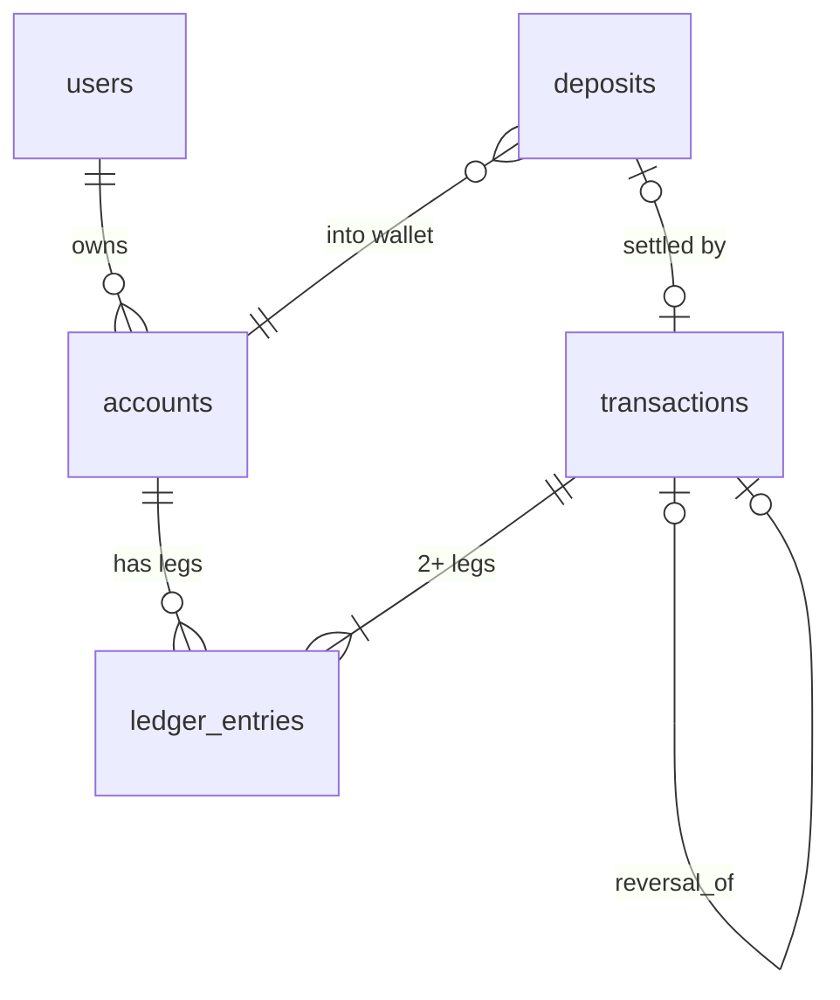
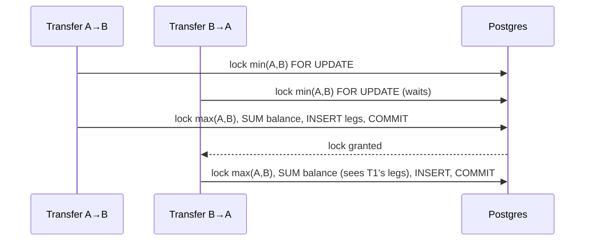

# Ledger design

## Model

- **accounts** are either `USER_WALLET`s (owned by a user) or `SYSTEM` accounts (one per code and currency: `EXTERNAL_FUNDING`, `REFUNDS_CLEARING`, `FX_CLEARING`).
- **transactions** are headers: a type, a human-readable reference (`TXN-20261027-8F3K2QXW`), who initiated it, and an optional `reversal_of_transaction_id`.
- **ledger_entries** are the legs: account, `DEBIT`/`CREDIT`, a positive `BIGINT` amount in minor units, and a currency.

## Sign convention

For every account: **balance = Σ CREDIT − Σ DEBIT**.

| Event | DEBIT | CREDIT |
|---|---|---|
| Deposit settles | `EXTERNAL_FUNDING` (goes negative) | user wallet |
| Transfer | sender wallet | receiver wallet |
| Reversal of the above | mirror image: every leg's direction flipped | |

`EXTERNAL_FUNDING`'s balance is therefore minus the total money customers have paid in. The sum of all account balances in a currency is always exactly 0. That's double-entry: money is never created or destroyed, it only moves between accounts.

## Invariants and where each is enforced

| Invariant | Java | Database | Reconciliation |
|---|---|---|---|
| Each transaction: ≥1 DEBIT, ≥1 CREDIT, debits = credits per currency | `LedgerService.assertBalanced` | deferred constraint trigger, checked at COMMIT | checks 1, 2 |
| Entries are never updated or deleted | JDBC inserts only, no JPA entity | `BEFORE UPDATE/DELETE/TRUNCATE` trigger + `REVOKE` from app role | — |
| Leg currency = account currency | `LedgerService` | composite FK `(account_id, currency)` | — |
| Amount > 0 | `LedgerService` | `CHECK (amount > 0)` | — |
| User wallet never negative | balance check under row lock | — | check 3 |
| A transaction is reversed at most once | `ReversalService` check under locks | partial unique index | check 6 |
| A SUCCEEDED deposit has exactly one matching DEPOSIT transaction | `DepositService` (locked settle) | `CHECK (succeeded ⇔ transaction_id)`, unique `transaction_id` | check 5 |

## Concurrency

Both transfers lock in the same global order (UUID text order), so neither can hold the lock the other is waiting for. See ADR-012.

## Corrections

Rows are never edited. A mistake is fixed with a `REVERSAL` transaction (ADR-016). An auditor can always reconstruct what happened, including the mistake and who corrected it and why. The reason is in `audit_log` and in the reversal's metadata.
