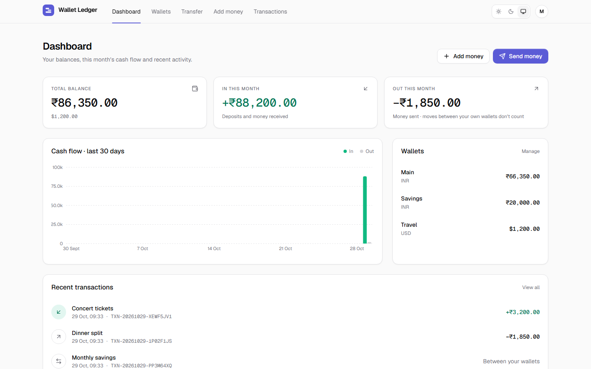
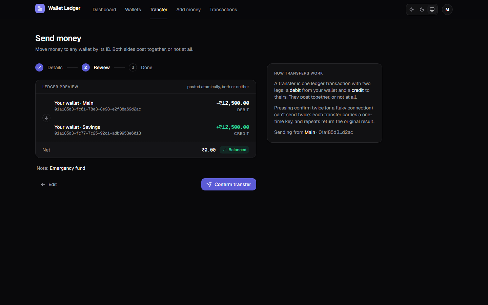
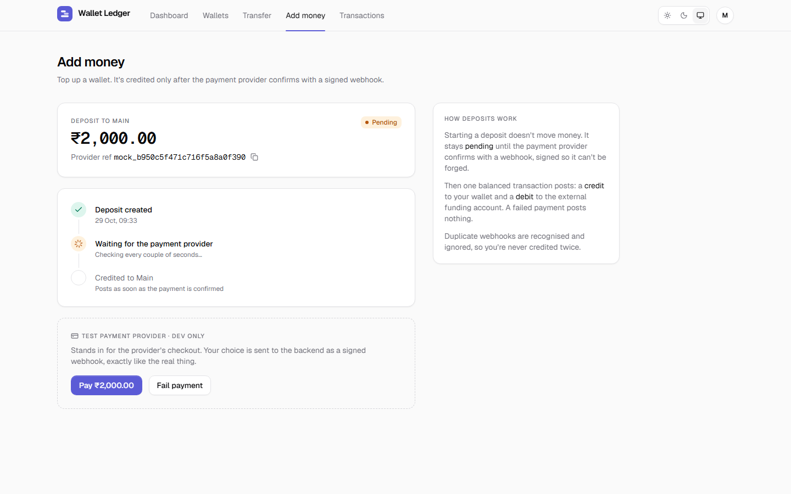
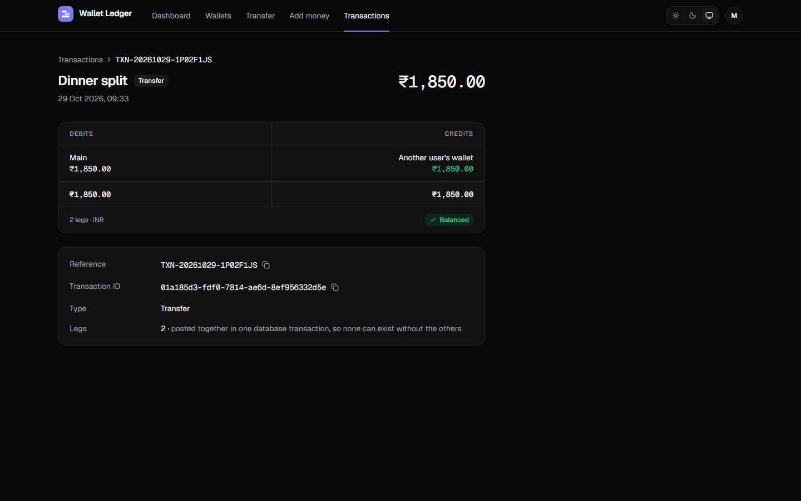
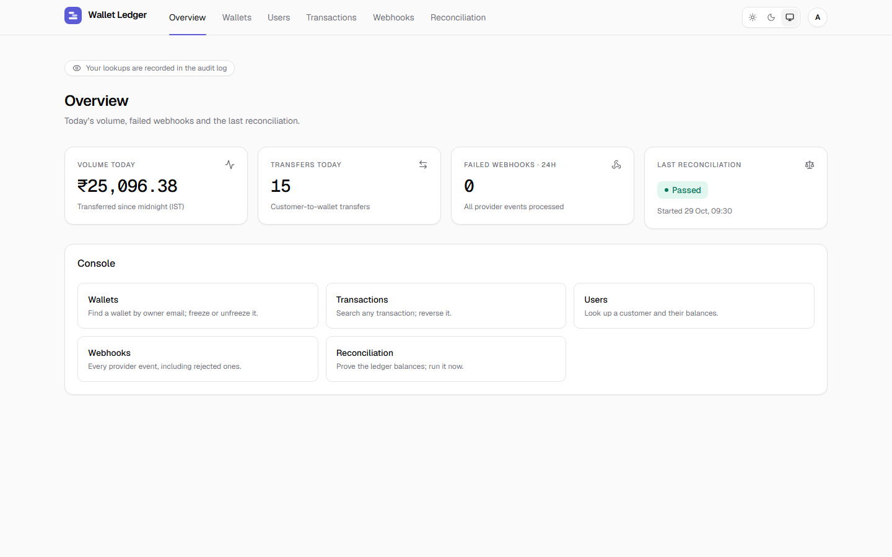
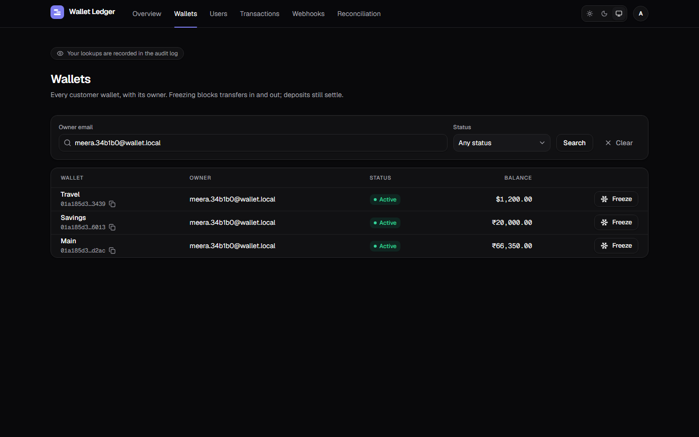
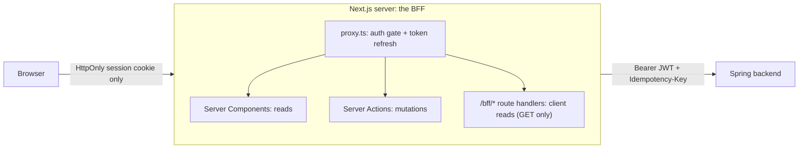

# Wallet Ledger: web

The Next.js frontend for the wallet backend. A customer app (wallets, transfers, deposits, transactions) and a staff console (admin and support), built to make the backend's guarantees **visible**: balances that always add up, transfers that can't double-submit, deposits confirmed by a signed webhook, and an audited console.

**Stack:** Next.js 16 (App Router, Cache Components) · React 19 · TypeScript · Tailwind 4 · shadcn/ui (re-themed) · TanStack Query · react-hook-form + Zod · iron-session · openapi-typescript · Vitest · Playwright + axe

|                                                                 |                                                                  |
| --------------------------------------------------------------- | ---------------------------------------------------------------- |
|            |  |
|        |   |
|  |      |

Every screen exists in light and dark: see [`docs/screenshots/`](../docs/screenshots/).

## Run it

Needs **Node.js ≥ 20.9** (22 LTS, see `.nvmrc`), plus the backend's requirements (JDK 21, Docker).

```bash
# 1. Backend (from the repo root): Postgres on :5433, API on :8080 with seeded demo users
docker compose up -d
cd backend && ./mvnw spring-boot:run

# 2. Frontend
cd web
cp .env.example .env.local            # then set SESSION_SECRET (command in the file)
npm ci
npm run dev                           # http://localhost:3000
```

With `MOCK_PROVIDER_ENABLED=true`, the sign-in page lists the demo accounts:

| Role     | Email                  | Password           |
| -------- | ---------------------- | ------------------ |
| Customer | `alice@wallet.local`   | `alice-pass-123`   |
| Customer | `bob@wallet.local`     | `bob-pass-123`     |
| Support  | `support@wallet.local` | `support-pass-123` |
| Admin    | `admin@wallet.local`   | `admin-pass-123`   |

> The backend's optional observability profile runs Grafana on :3000 too. Run the web app on another port (`npm run dev -- -p 3001`) if you use both.

## Environment

All server-side; nothing is `NEXT_PUBLIC_*`, so the browser never learns the backend URL or any secret.

| Variable                                   | Purpose                                                                                                                                                        | Default                 |
| ------------------------------------------ | -------------------------------------------------------------------------------------------------------------------------------------------------------------- | ----------------------- |
| `API_BASE_URL`                             | where the Spring backend listens                                                                                                                               | `http://localhost:8080` |
| `SESSION_SECRET`                           | encrypts the session cookie; **at least 32 random characters** (the app refuses to start otherwise)                                                            | none                    |
| `MOCK_PROVIDER_ENABLED`                    | dev only: lists the seeded demo accounts on /login (and implies `DEMO_PAYMENTS_ENABLED`). **Unset in production.**                                             | off                     |
| `DEMO_PAYMENTS_ENABLED`                    | "Add money" completes with a labelled, simulated payment; the backend's switch of the same name must be on too                                                 | off                     |
| `LLM_API_KEY` / `LLM_MODEL`                | "Ask your wallet": key and model for an OpenAI-compatible chat API; the feature is hidden unless both are set                                                  | unset                   |
| `LLM_BASE_URL`                             | the provider: Gemini (default) `https://generativelanguage.googleapis.com/v1beta/openai`, OpenRouter `https://openrouter.ai/api/v1`, xAI `https://api.x.ai/v1` | Gemini                  |
| `ASSISTANT_DAILY_LIMIT`                    | questions per customer per day (in memory, per server process)                                                                                                 | `20`                    |
| `DEMO_LOGIN_EMAIL` / `DEMO_LOGIN_PASSWORD` | optional public demo customer shown on /login; must match the backend's `BOOTSTRAP_DEMO_*`                                                                     | unset                   |

## Scripts

| Command                                                       | What it does                                                                            |
| ------------------------------------------------------------- | --------------------------------------------------------------------------------------- |
| `npm run dev` · `npm run build` · `npm start`                 | dev server · production build · serve the build                                         |
| `npm run lint` · `npm run typecheck` · `npm run format:check` | quality gates (`typecheck` runs `next typegen` first, for typed routes)                 |
| `npm test`                                                    | unit tests (Vitest)                                                                     |
| `npm run test:e2e`                                            | end-to-end tests (Playwright) against the real backend, see [Testing](#testing)         |
| `npm run gen:api`                                             | regenerate `src/lib/api/schema.d.ts` from `../backend/openapi.json`                     |
| `node scripts/screenshot-app.mjs`                             | portfolio screenshots of the main screens into `docs/screenshots/` (needs both servers) |
| `node scripts/screenshot-design.mjs`                          | screenshots of the `/design` style guide                                                |

## Architecture



**Backend-for-frontend (BFF).** The browser never sees a JWT. After sign-in, the access and refresh tokens live in an encrypted, `HttpOnly`, `SameSite=Lax` cookie (`wl_session`, iron-session). Pages read on the server; mutations are Server Actions (CSRF-protected by Next's origin check); the few reads the client must make itself (infinite lists, deposit polling) go through GET-only `/bff/*` routes. All three call the backend with the token from the cookie.

**Token refresh** happens in one place, `src/proxy.ts`, because it runs before every request and is allowed to write cookies (pages aren't). When under 60 seconds of the access token remain, it refreshes and hands the new session both to the current request and back to the browser. Refresh tokens rotate and the backend treats a reused one as theft, so parallel requests must not refresh twice: refreshes are **single-flight** per refresh token, and a just-rotated result is remembered for 60 seconds for the stragglers (`src/lib/session/refresh.ts`). This is per server process; behind several instances, use sticky sessions or move that map to Redis.

**Idempotency.** Every money-moving form gets one `Idempotency-Key` per user intent (`src/lib/idempotency.ts`): created on the first submit, **reused** for re-submits (double-click, retry, flaky network), so the backend replays the original result instead of moving money twice. It's discarded when the user edits the form or a definite answer arrives. The e2e suite double-clicks "Confirm" and checks that exactly one transaction exists.

**Money** is integer minor units end to end. `src/lib/money.ts` parses and formats with `BigInt`, never `parseFloat` (`"1.005"` is rejected, not rounded), and the server re-parses everything the browser sends.

**Errors.** The backend answers with RFC 7807 problems carrying a stable `code`. `src/lib/errors.ts` maps every code to friendly copy in one place; business errors are placed on the field they concern (insufficient funds under the amount). Unexpected errors show a reference (the backend's `correlationId`, or Next's error digest) that finds the server log line.

**Roles.** `proxy.ts` sends each role to its area (customer `/dashboard`, support `/support/users`, admin `/admin`), hiding is UX only: the backend enforces every rule, and a customer calling a staff BFF route gets a 403 from it.

**Contract.** Types come from the backend's OpenAPI document (`npm run gen:api`); CI fails if they drift.

**"Ask your wallet" (LLM).** A customer chat page (`/assistant`) that answers questions about the user's own
money with tool calling (`src/lib/assistant/`). The model can only call three **read-only** tools
(`list_wallets`, `summarize_transactions`, `search_transactions`), and the tools call the backend with the user's
own token, so it can't see other people's data or move money. Totals are computed in code, in integer minor
units: the model quotes them, it never adds up amounts itself. Transaction notes are written by other users,
so they reach the model as fields named `untrustedNote`, which the system prompt says never to follow; answers
render as plain text. Each question is capped (500 characters, 5 tool rounds) and each customer gets a daily
limit. The key stays on the server. Provider-neutral: any OpenAI-compatible API with tool calling (Gemini,
OpenRouter, xAI).

## Screens

| Area            | Routes                                                                                                                                                                     |
| --------------- | -------------------------------------------------------------------------------------------------------------------------------------------------------------------------- |
| Public          | `/login`, `/register`, `/design` (style guide)                                                                                                                             |
| Customer        | `/dashboard`, `/wallets`, `/wallets/[id]`, `/transfer`, `/deposit`, `/transactions`, `/transactions/[id]`, `/settings`, `/assistant`                                       |
| Support + admin | `/support/users`, `/support/users/[id]`, `/support/transactions`, `/support/transactions/[id]`, `/support/webhook-events`, `/admin/reconciliation` (read-only for support) |
| Admin           | `/admin`, `/admin/wallets`, `/admin/transactions/[id]/reverse`, "Run now" on reconciliation                                                                                |

Every staff page notes "Your lookups are recorded in the audit log", which is true: the backend audits every support read.

## Testing

- **Unit (Vitest), `npm test`:** money parsing and formatting edge cases, error-code mapping, transaction filter parsing (IST day boundaries), and the idempotency-key hook.
- **End-to-end (Playwright), `npm run test:e2e`:** runs against the real backend in its dev profile and a production build (started for you if nothing is on :3000):

  ```bash
  docker compose up -d && (cd backend && ./mvnw spring-boot:run)   # in another terminal
  npm run build && npm run test:e2e
  ```

  It covers: the dashboard; creating a wallet and transferring (balance, entries, both legs); a double-clicked confirm creating one transaction; a deposit through the mock provider crediting the exact amount; insufficient funds (client and server side); not-found for another user's wallet; admin freeze/unfreeze blocking a transfer; reversal with a reason and the already-reversed refusal; reconciliation; support lookups without admin actions; customers kept out of the console; the session cookie being `HttpOnly` with no JWT in the page; sign-out; and off-site redirect protection. **axe** checks the main pages of every role in light and dark for serious or critical WCAG 2.1 AA violations.

  The silent-refresh test needs a token that expires during the run. Start the backend with `SECURITY_AUTH_ACCESS_TOKEN_TTL=75s` and run with `E2E_SHORT_TOKEN_TTL=1`; otherwise it's skipped.

- **CI** (`.github/workflows/web-ci.yml`, on changes to `web/**` or the contract): generated-types drift check, format, lint, typecheck, unit tests, build. The e2e suite stays local (about 3 minutes, and it needs Postgres plus the backend); run it before a release.

## Design system

A premium, quiet look (Linear/Stripe territory): Geist and Geist Mono, one indigo accent used sparingly, hairline borders and layered shadows, tabular figures for every amount. Tokens live in `src/app/globals.css` (light and dark both first-class, WCAG AA contrast checked by the e2e suite); components in `src/components/ui` are shadcn re-themed onto those tokens; ledger-specific pieces (`Amount`, `TAccount`, `DoubleEntryPreview`, `StatusBadge`…) are in `src/components/ledger`. Motion respects `prefers-reduced-motion`. `/design` shows all of it.

## Layout

```
src/
  app/
    (auth)/            sign-in, register, their Server Actions
    (app)/             signed-in shell; customer pages, admin/ and support/ console
    bff/               GET-only route handlers for client-side reads
    design/            style guide
  components/          ui/ (shadcn), ledger/, data/, forms/, shell/, charts/, motion/, states/
  lib/
    api/               typed backend client, generated schema, BFF helpers
    session/           cookie sealing, refresh single-flight
    money.ts errors.ts idempotency.ts tx-filters.ts format.ts
  proxy.ts             auth gate + token refresh
e2e/                   Playwright suite
```

## Troubleshooting

- **`SELF_SIGNED_CERT_IN_CHAIN` / `UNABLE_TO_GET_ISSUER_CERT_LOCALLY` from npm or Node:** antivirus HTTPS scanning (e.g. Avast) or a corporate proxy re-signs TLS with a root only Windows trusts. Tell Node to use the OS store: `NODE_OPTIONS=--use-system-ca` (Node ≥ 22.15). Don't disable TLS verification.
- **`SESSION_SECRET must be set`:** copy `.env.example` to `.env.local` and generate a secret with the command in that file.
- **e2e: "Backend not reachable":** start Postgres and the backend first (see above); the suite checks `/actuator/health` before running.
